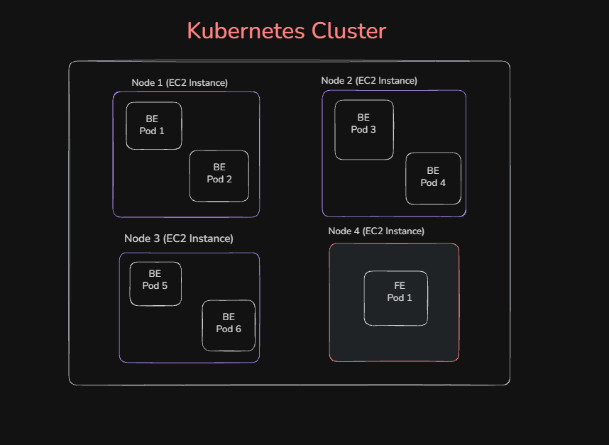

# Kubernetes

## Definition

Kubernetes (K8s) is an open-source container orchestration platform used to automate the deployment, scaling, management, and monitoring of containerized applications across a cluster of machines.

## Key Terms

- **Container:** A lightweight, isolated environment used to run an application along with its dependencies.

- **Orchestration:** The automated process of deploying, managing, scaling, and coordinating multiple containers.

- **Cluster:** A group of machines (called nodes) that work together to run and manage applications.

## When Is Kubernetes Useful?

- When you want to deploy containerized applications across a cluster.
- When you want automated recovery from certain container or Pod failures.
- When you need to scale application workloads.
- When you want to manage application deployments across multiple machines.

## Diagram

